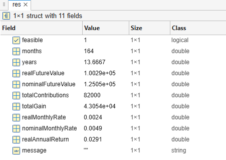
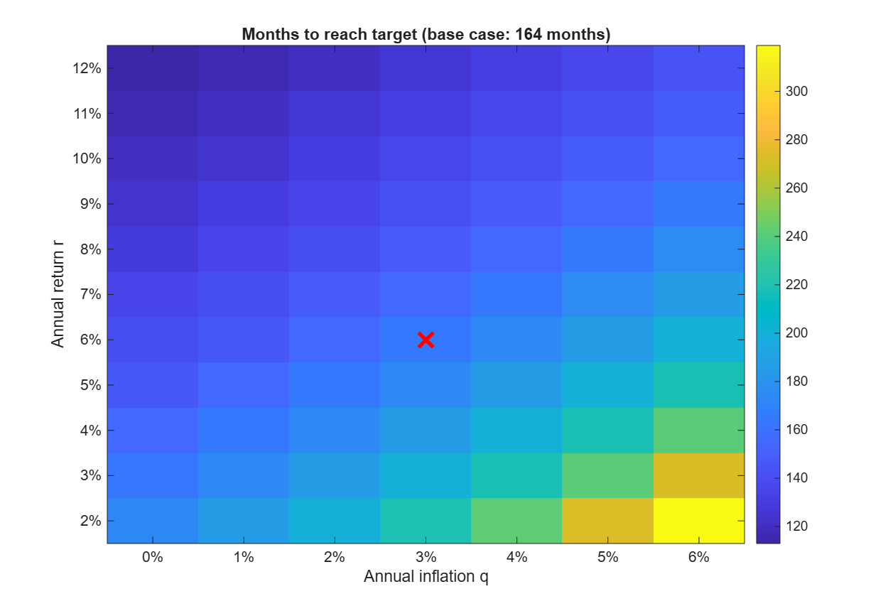
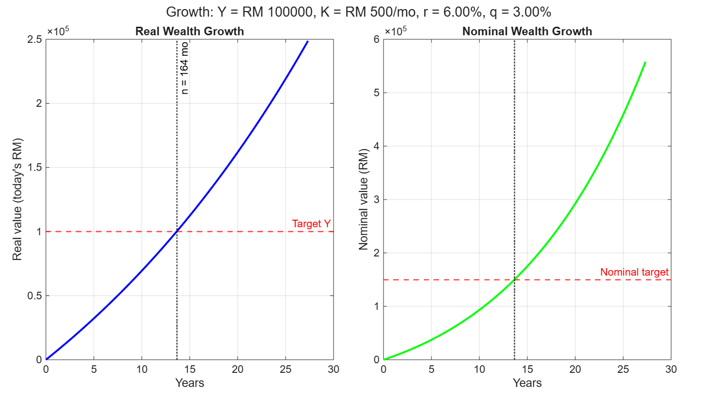

# hackathon-matlab-1
Repo for dumping crap for UTM Hackathon MATLAB for degree newbies.

## The Question for the Demonstration

#### Design a calculator that estimates the time required for a fixed monthly investment to reach a target real future value.

**Inputs:**
- $Y$: target amount in today’s RM, i.e., real value, with $Y>0$.
- $K$: fixed monthly contribution, made at the end of each month, with $K>0$.
- $r$: assumed constant effective annual return of a low-risk fixed-income fund, as a decimal.
- $q$: assumed constant annual inflation rate, as a decimal.

**Assumptions:**
- Returns compound monthly.
- Contributions are constant and never missed.
- There are no taxes, fees, or withdrawals.

**Task:**
Compute the smallest integer number of months $n$, and the corresponding time $T=n/12$ years, such that the inflation-adjusted real value of the investment is at least $Y$.

Use:

$$
r_{\text{real}}=\frac{1+r}{1+q}-1,\qquad
i=(1+r_{\text{real}})^{1/12}-1
$$

If $i\ne 0$, the real value after $n$ months is:

$$
FV(n)=K\frac{(1+i)^n-1}{i}
$$

If $i=0$, use:

$$
FV(n)=Kn
$$

Solve $FV(n)\ge Y$.

The calculator should also display the nominal accumulated value, total contributions, and total investment gain. If the goal is infeasible because $i<0$ and $Y\ge K/(-i)$, report that the target cannot be reached under the given assumptions.

### Outputs from several solution attempts

#### hackathon01_01

Screenshotted because too lazy to export the table.

#### hackathon01_02

Target reached in 164 months (13.67 years).
Real future value:        RM 100294.92
Nominal future value:     RM 150217.67
Total nominal contributions: RM 101162.30
Nominal gain:             RM 49055.36
Real monthly rate:        0.239537%
Real annual return:       2.9126%

#### hackathon01_03

Target reached in 164 months (13.67 years).
Binary search iterations:    7
Real future value:           RM 100294.92
Nominal future value:        RM 150217.67
Total nominal contributions: RM 101162.30
Nominal gain:                RM 49055.36

#### hackathon01_04

Expected real annual return: 2.9126%
Annual volatility:           10.00%
P(reach target):             1.0000

Percentile months to reach target (conditional on reaching):
  10th pct:  132.0 months  (11.00 years)
  25th pct:  145.0 months  (12.08 years)
  50th pct:  163.0 months  (13.58 years)
  75th pct:  184.0 months  (15.33 years)
  90th pct:  208.0 months  (17.33 years)
  95th pct:  223.0 months  (18.58 years)

Months required for target probabilities:
  P(reach) >= 0.50  ->   168.0 months  (14.00 years)
  P(reach) >= 0.75  ->   192.0 months  (16.00 years)
  P(reach) >= 0.90  ->   216.0 months  (18.00 years)
  P(reach) >= 0.95  ->   228.0 months  (19.00 years)

#### hackathon01_05

